  

<h1 align="center" style="color: #fef3c7; font-size: 42px;">🌟 badhope 🌟</h1>

  AI-Native Full-Stack Developer 
  Building with Starry Skies

  

  
  
  

  

---

<table>
  <tr>
    <td width="33%" valign="top">
      

        
         
        <b>⭐ 基本信息</b>
          
        <b>badhope</b> 
        📍 深圳龙华 · 广东 🇨🇳 
        🔭 正在构建AI原生应用 
        📚 学习高级LLM编排 
        🤝 开启有趣项目的合作
          
        <a href="mailto:x18825407105@outlook.com">📧 邮件</a> ·
        <a href="https://github.com/badhope">🐙 GitHub</a>
      

    </td>
    <td width="33%" valign="top">
      

        
         
        <b>💡 当前状态</b>
          
        
          
        <b style="font-size: 18px; color: #fef3c7;">✨ 活跃开发中</b>
         
        <small style="color: #a5f3fc;">专注于AI原生应用开发</small>
          
        <small style="color: #c4b5fd;">最后更新: 2026-04-04</small>
      

    </td>
    <td width="33%" valign="top">
      

        
         
        <b>🎯 技术方向</b>
          
        <b>AI & LLM</b> 
        Agent开发 · RAG系统 
        智能工作流编排 
         
        <small style="color: #c4b5fd;">Python · TypeScript · FastAPI</small>
      

    </td>
  </tr>
</table>

  

---

<table>
  <tr>
    <td width="33%" valign="top">
      

        
         
        <b>💻 技术栈</b>
          
        
          
        
        
        
        
          
        <b>核心技能:</b> 
        AI & LLM · 全栈开发 · 数据工程 · DevOps
      

    </td>
    <td width="33%" valign="top">
      

        
         
        <b>📊 GitHub统计</b>
          
        
         
        
      

    </td>
    <td width="33%" valign="top">
      

        
         
        <b>📝 动态内容</b>
          
        
          
        <!-- quote:start -->
        <b>✨ 每日星语</b>
         
        <small>*"The best way to predict the future is to build it."*</small>
        <!-- quote:end -->
          
        <!-- blog:start -->
        <b>📚 最新文章</b>
         
        <small>文章同步中...</small>
        <!-- blog:end -->
      

    </td>
  </tr>
</table>

  

---

<table>
  <tr>
    <td width="50%" valign="top">
      

        
         
        <b>🚀 精选项目</b>
          
        
         
        
      

    </td>
    <td width="50%" valign="top">
      

        
         
        <b>✒️ 开发者寄语</b>
          
        
          
        

          

            <b>"在星空下编程，让每一行代码都闪耀着智慧的光芒。"</b>
          

          

            — badhope · 星际开发者
          

        

         
        

          🌟 追逐梦想的代码之旅 🌟
        

      

    </td>
  </tr>
</table>

  

  

  

  <b style="color: #fef3c7; font-size: 18px;">✨ 感谢访问我的星空 ✨</b>
   
  <small style="color: #a5f3fc;">Last updated: 2026-04-04 | Made with 🌟 and 💖</small>

