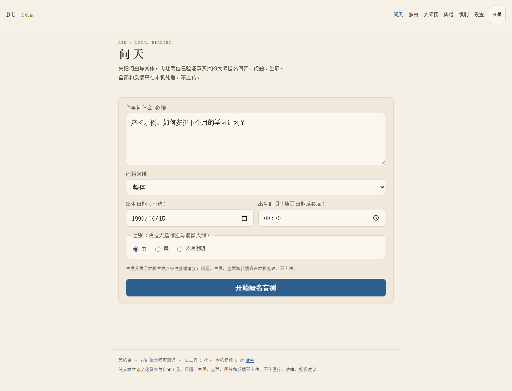
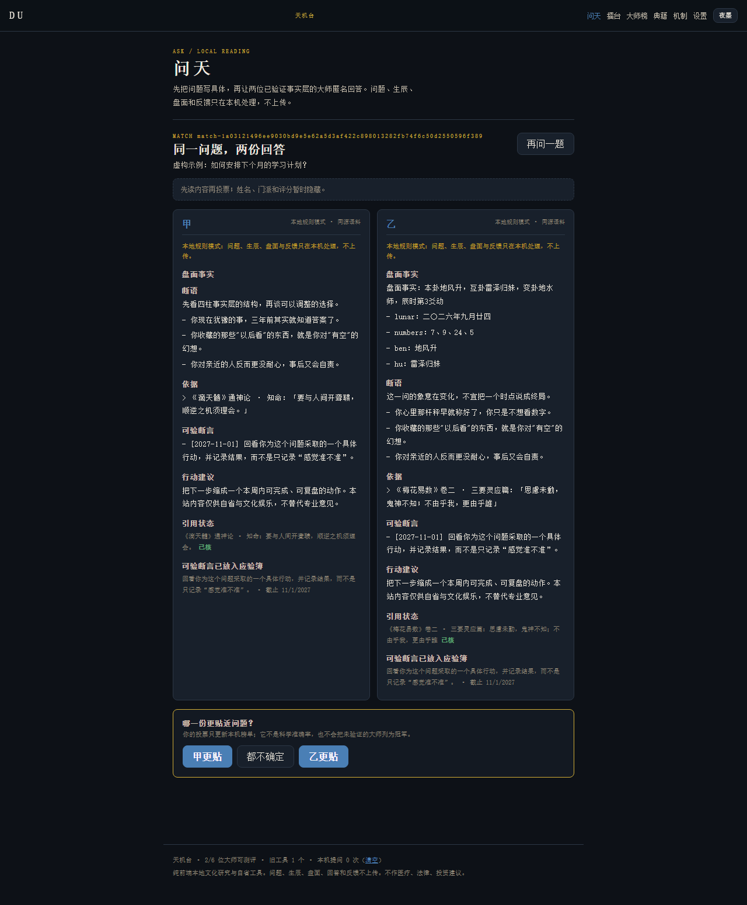
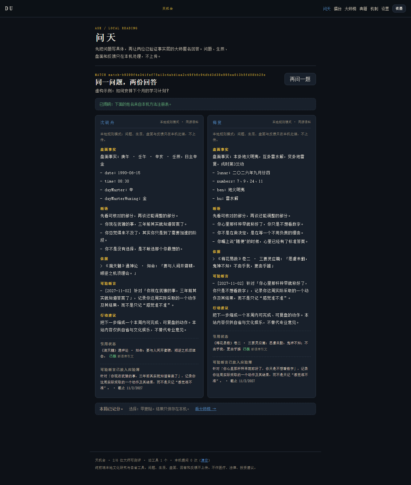

# Tianji · DU <sub>v0.7.1</sub>

Two schools read the same question. You score them blind, then the names appear.
Dated claims go into a ledger you resolve yourself a week later.

[中文](README.zh-CN.md) · [Roadmap](ROADMAP.md) · [Changelog](CHANGELOG.md)

| Ask | Blind match | After voting |
| --- | --- | --- |
|  |  |  |

## Install

```bash
# CLI
npm ci && npm run build:all
node build/cli.mjs ask "Should I change jobs this quarter?" --domain career --gender female

# Desktop (Windows, no Node needed)
build/install.cmd
tianji serve                 # http://127.0.0.1:7317

# MCP (Claude / VS Code / Cursor)
{ "mcpServers": { "tianji": { "command": "tianji", "args": ["mcp"] } } }
```

## What it does

| Step | What happens |
| --- | --- |
| Ask | Write one concrete question. Birth date is optional — it unlocks the four pillars and Zi Wei charts. |
| Score blind | Two anonymous answers. Names, schools and charts stay sealed until you vote. |
| Reveal | After voting you see who wrote which, and where every quotation comes from. |
| Resolve | Dated, falsifiable claims enter a ledger. Come back in a week and mark what happened. |

Kernels: Zi Ping four pillars, Mei Hua Yi Shu, Zi Wei Dou Shu. All computed on
your device; nothing is uploaded. Sex decides decadal luck direction and is used
only as a calendar input — never as a prediction target.

## Why the readings are checkable

Every quoted line is verified verbatim against the public-domain corpus in
`public/corpus` (12 classics, about 1.87M characters). `npm run check` fails if a
quote cannot be found there, so a citation cannot drift away from its source.

## License

MIT. Public-domain sources for the classics are listed in
`public/corpus/manifest.json`.
