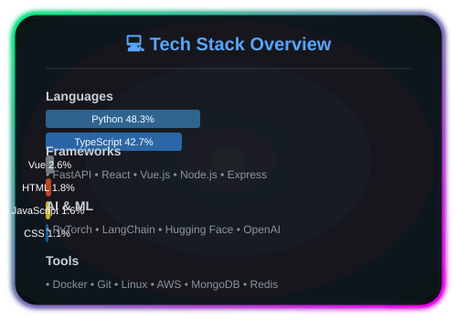
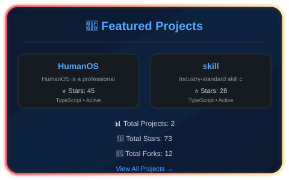

<!-- 动态星空背景 -->

# 🌌 badhope

### AI-Native Full-Stack Developer

<!-- 打字机效果 -->

 

<!-- 流动分隔线 -->

  

## 💻 Tech Stack

<!-- 技术栈展示面板 -->

  

### Languages & Frameworks

### Frontend

### Backend & APIs

### AI & ML

### Tools & Platforms

<!-- 流动分隔线 -->

  

## 📊 GitHub Stats

<!-- 流动分隔线 -->

  

## 🚀 Featured Projects

<!-- 项目展示卡片 -->

  

<table>
<tr>
<td width="50%">

### [-thinkcheck-lib-](https://github.com/badhope/-thinkcheck-lib-)

Resonance Theory LLM reasoning monitoring framework

</td>
<td width="50%">

### [MindMirror](https://github.com/badhope/MindMirror)

See Yourself Clearly, Become Your Best Self

</td>
</tr>
<tr>
<td width="50%">

### [DevFlow-Agent](https://github.com/badhope/DevFlow-Agent)

Development Workflow Agent - 7 Core Skills + 16 Workflows

</td>
<td width="50%">

### [AgentHome](https://github.com/badhope/AgentHome)

AI Agent Development Toolkit - Build Agents Like Building Blocks

</td>
</tr>
</table>

[View All Projects →](https://github.com/badhope?tab=repositories)

<!-- 流动分隔线 -->

  

## 🐍 Contribution Snake

_If snake not visible, check [snake animation branch](https://github.com/badhope/badhope/tree/output)_

<!-- 流动分隔线 -->

  

## 📈 Activity Graph

<!-- 流动分隔线 -->

  

## ✨ Daily Inspiration

<!-- quote:start -->
> _"Shoot for the moon. Even if you miss, you'll land among the stars."_ — Les Brown
<!-- quote:end -->

<!-- 流动分隔线 -->

  

## 📚 Latest Articles

<!-- blog:start -->

<small>1. 📕 <a href="https://blog.csdn.net/weixin_56622231/article/details/161027666" style="color:#a5f3fc;text-decoration:none;">从感知机到多层神经网络的数学演进，深度学习演变</a></small> 
<small>2. 📕 <a href="https://blog.csdn.net/weixin_56622231/article/details/161007981" style="color:#a5f3fc;text-decoration:none;">数据挖掘感知机模型全面解析，从理论原理到完整代码实战教程(附代码)</a></small> 
<small>3. 📕 <a href="https://blog.csdn.net/weixin_56622231/article/details/161007532" style="color:#a5f3fc;text-decoration:none;">线性代数全章节梳理，核心知识点深度解析</a></small> 

<!-- blog:end -->

<!-- 流动分隔线 -->

  

## 🌟 Let's Connect!

**Thanks for visiting!** 🚀

_Made with ❤️ by **badhope**_

<!-- 底部动态星空 -->

