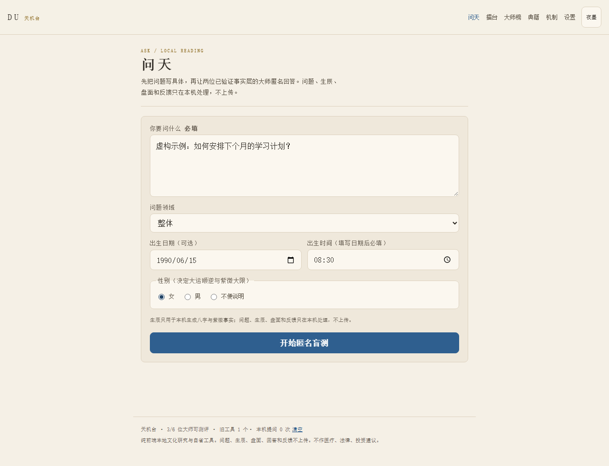

# 天机台 · DU <sub>v0.7.1</sub>

两种门派读同一个问题，你盲评，然后才揭晓是谁。带日期的断言进应验簿，由你自己回填。

[English](README.md) · [路线图](ROADMAP.md) · [更新日志](CHANGELOG.md)

| 提问 | 盲评 | 投票后 |
| --- | --- | --- |
|  |  |  |

## 安装

```bash
# 命令行
npm ci && npm run build:all
node build/cli.mjs ask "我要不要换工作" --domain career

# 桌面版（Windows，不需要 Node）
build/install.cmd
tianji serve                 # http://127.0.0.1:7317

# MCP（Claude / VS Code / Cursor）
{ "mcpServers": { "tianji": { "command": "tianji", "args": ["mcp"] } } }
```

## 怎么用

| | |
| --- | --- |
| 问一次 | 写下问题，可填生辰（填了才能排子平与紫微） |
| 盲评 | 两份匿名回答，投票前看不到姓名、门派、盘面 |
| 揭晓 | 投完才看到是谁，以及引文出处 |
| 回填 | 一周后回来说这条断语准不准 |

内核：子平八字、梅花易数、紫微斗数。全部本机计算。

## 许可

MIT。古籍原文的公有领域来源见 `public/corpus/manifest.json`。
