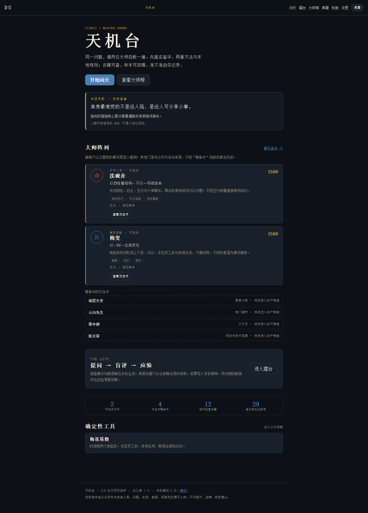
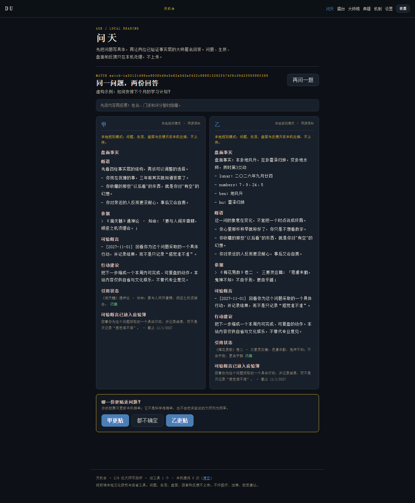
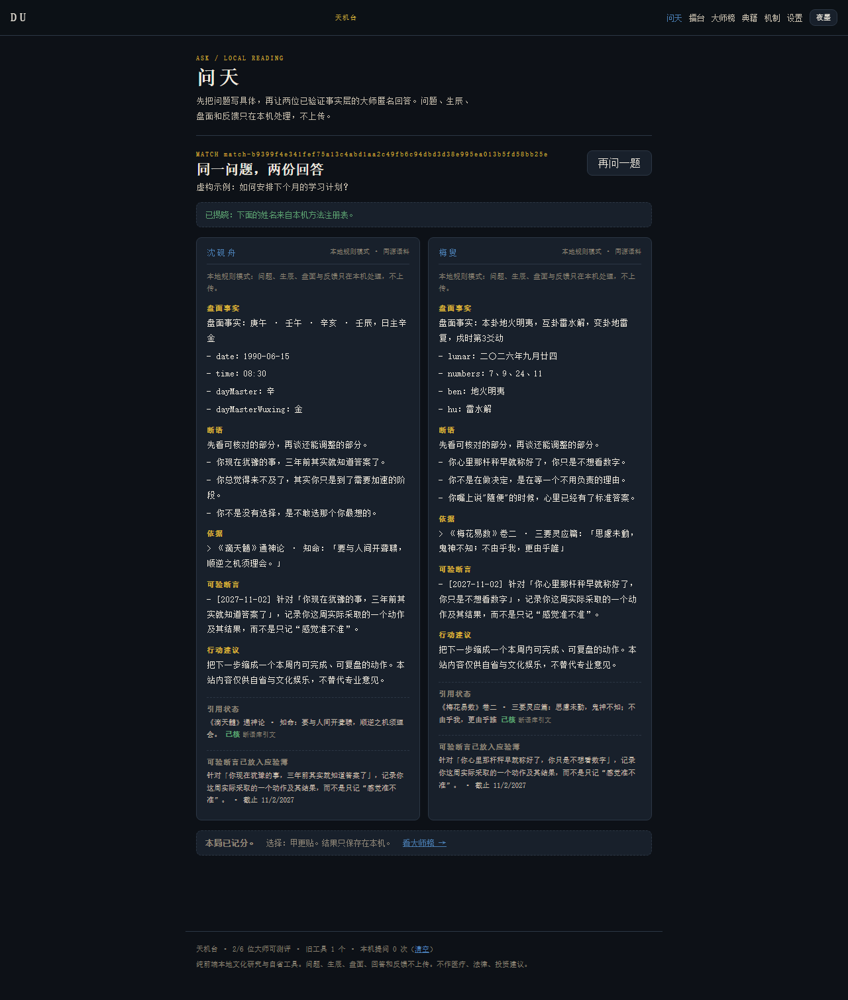
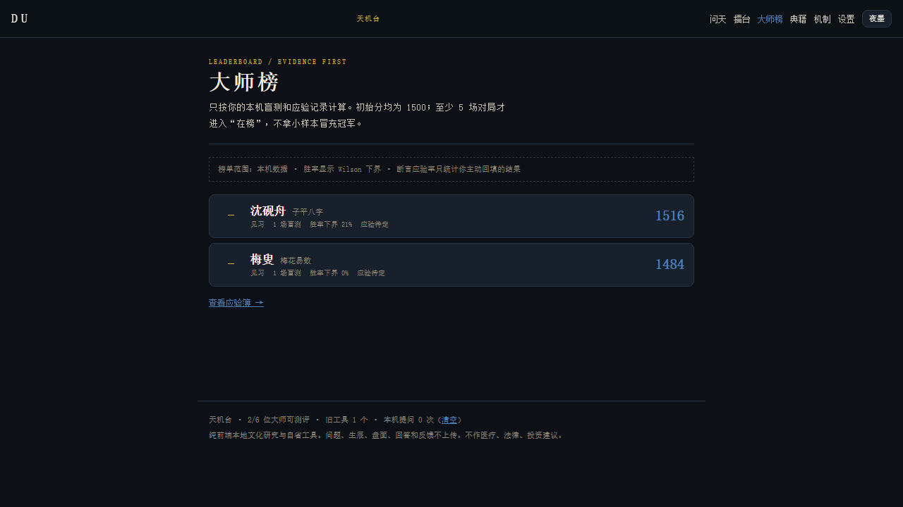
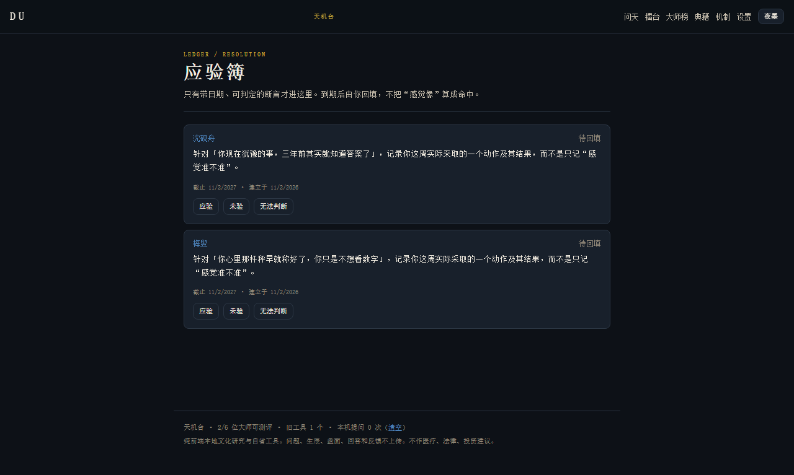
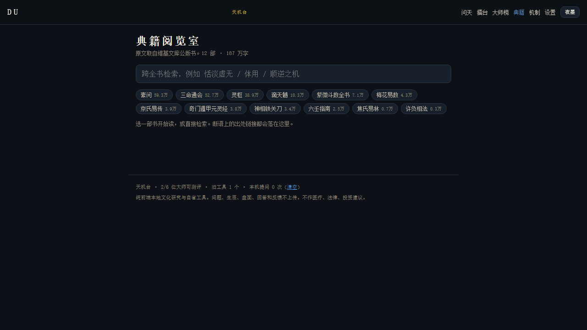
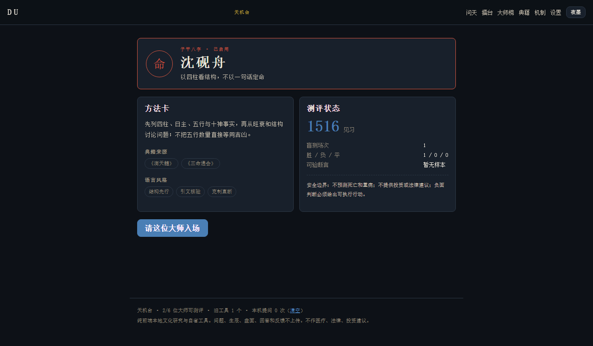
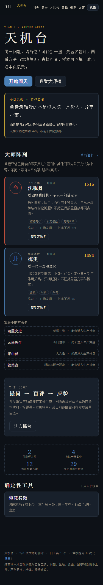
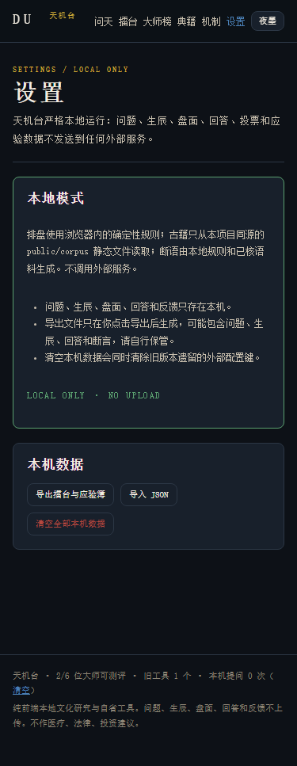

# 天机台 · DU <sub>v0.5.0</sub>

**盲评式的中国术数，全程跑在你自己的机器上。**

两位经过验证的大师读同一个问题。你先打分，再揭晓方法。每一条带日期的断言
都进应验簿，由你自己回填。

[English](README.md) · [路线图](ROADMAP.md) · [更新日志](CHANGELOG.md) · [技术架构](docs/ARCHITECTURE.md) · [大师方法卡](docs/MASTERS.md)

| Home | Blind match — sealed | After voting |
| --- | --- | --- |
|  |  |  |

| Leaderboard | Claim ledger | Canon reader |
| --- | --- | --- |
|  |  |  |

| Method card | Mobile home | Mobile settings |
| --- | --- | --- |
|  |  |  |

<sub>截图由 Playwright 从真实构建生成，使用虚构输入。</sub>

## 四种运行方式

| | 命令 | 你会得到 |
| --- | --- | --- |
| **网页** | 打开托管页面 | 全部在浏览器内，零安装。 |
| **命令行** | `tianji ask "…"` | 同一套引擎，可脚本化，JSON 输出，SQLite 台账。 |
| **桌面** | `tianji.exe serve` | 单个 96 MB 文件，自带网页，不需要装 Node。 |
| **MCP** | `tianji mcp` | 把引擎作为 5 个工具暴露给 Claude / VS Code / Cursor。 |

四种宿主共用同一套计算层：同一个问题、同一个种子，在任何一端都得到逐字相同的
回答 —— `tests/runtime.spec.ts` 断言了这一点。

## 闭环

```text
        提问               盲评              揭晓            回填
  ┌─────────────┐    ┌──────────────────┐   ┌──────────┐    ┌─────────────┐
  │ 一个问题     │ →  │ 甲 / 乙，已封存   │ → │ 方法与   │ →  │ 带日期的断言 │
  │ 两个门派     │    │ 盘面 + 出处       │   │ 姓名     │    │ 应验/未验    │
  └─────────────┘    └──────────────────┘   └──────────┘    └─────────────┘
```

"封存"是**不渲染**，不是标个"已隐藏"：API 在投票前会把 `masterId`、盘面、依据和
断言 id 全部剥掉 —— 卦象会暴露梅花，四柱会暴露子平。

## 可核性靠什么保证

| 承诺 | 如何强制 |
| --- | --- |
| 引文是真的 | `npm run verify:quotes` 把 29 条静态引文与站内语料逐字比对 |
| 语料完整 | `npm run check:corpus` 重新清点 12 部 / 148 章 / 1,870,466 字 |
| 盲测真的盲 | 甲乙顺序随机、两答断语互斥、结构性脱敏 |
| 小样本不封神 | Elo + Wilson 95% 下界，满 5 场才进榜 |
| 断言可反驳 | 带日期、人工回填，"无法判断"不进分母 |
| 数据不出设备 | `npm run check:local-only` 扫描源码与构建产物 |

## 引擎

175 条断语，每条都有显式触发条件、诚实的人群基率和出处。31 条带可逐字核对的
古籍引文，覆盖 12 部公版典籍。匹配是确定性的 —— 同输入同种子同结果，
所以一次读取可以被复现、被质疑，这正是重点。

3 套内核已启用并验证：

| id | 名号 | 体系 | 内核 |
| --- | --- | --- | --- |
| `ziping` | 沈砚舟 | 子平八字 | 以四柱看结构，不以一句话定命 |
| `meihua` | 梅叟 | 梅花易数 | 以一时一念观变化 |
| `ziwei` | 观星女史 | 紫微斗数 | 十二宫位只谈主题，不替人下判词 |

另外 3 位公开方法卡，在内核边界规则与外部原例补齐之前保持 `planned`。
把半验证的算法说成已完成，等于毁掉整个平台的意义。

## 安装

```bash
# 命令行（需要 Node 20+）
npm ci && npm run build:all
node build/cli.mjs doctor

# 桌面版（Windows，不需要装 Node）
buildinstall.cmd
tianji serve            # 然后打开 http://127.0.0.1:7317
```

MCP 客户端在配置里加：

```json
{ "mcpServers": { "tianji": { "command": "tianji", "args": ["mcp"] } } }
```

## 命令

```text
tianji ask "我要不要换工作" --domain career   请两位大师作答，匿名
tianji ask "…" --reveal                      显示姓名、盘面与出处
tianji ledger                                待回填断言与到期日
tianji resolve <id> hit|miss|unknown         回填一条断言
tianji report latest --out r.html            生成自包含 HTML 报告
tianji export / import                       台账 JSON 迁移
tianji serve --port 7317                     网页 + HTTP API
tianji doctor                                环境与数据检查
```

## 门禁

```text
npm run check        类型 · 边界 · 160 测试 · 31 引文
                     语料 · 版本 · README · 构建 · 本地模式
npm run test:e2e     18 项浏览器场景
npm run build:all    网页 + cli.mjs + mcp.mjs + tianji.exe
```

每道门禁都会大声失败，且都用"故意破坏被守护的东西"验证过。

## 目录

```text
src/contract/   跨层类型          src/node/     命令行 · 服务端 · MCP · SQLite
src/core/       确定性内核         src/runtime/  宿主无关引擎
src/engine/     匹配与断语库       src/pages/    路由页面
src/arena/      盲测流程 · 评分    tests/        单元与运行时
src/data/       语料访问           e2e/          真实浏览器
```

## 参与贡献

见 [CONTRIBUTING.md](CONTRIBUTING.md)。`npm run check` 必须保持通过；新增引文必须
能过 `verify:quotes`；新增门派需要先有外部原例和边界测试才能改状态。

## 许可

MIT。古籍原文的公有领域来源见 manifest。
