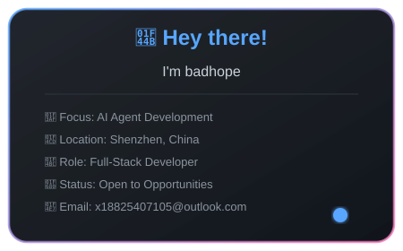

<div align="center">

<!-- 动态星空背景 -->


# 🌌 badhope

### AI-Native Full-Stack Developer | Building the Future with Code & Stars

<!-- 打字机效果 -->


<br/>

[](https://github.com/badhope)
[](mailto:x18825407105@outlook.com)
[]()


</div>

<!-- 流动分隔线 -->
<p align="center">
  
</p>

## 👋 About Me

<!-- 发光卡片 -->
<p align="center">
  
</p>

<div align="center">

**Hey there! I'm badhope**, a passionate developer crafting intelligent systems at the intersection of AI and software engineering.

### 🎯 What I Do

- 🔭 **Building** AI-native applications with LLM agents and RAG systems
- 📚 **Learning** advanced orchestration patterns and multi-agent architectures
- 💡 **Creating** open-source tools that empower developers
- 🤝 **Collaborating** on innovative projects that push boundaries

### 🌟 Current Focus

```
AI Agent Development · RAG Systems · Workflow Automation
Full-Stack Engineering · DevOps · Cloud Architecture
```

### 📈 Quick Stats

| Metric | Value |
|--------|-------|
| 🎯 **Focus Area** | AI Agent Development |
| 📍 **Location** | Shenzhen, China |
| 💼 **Role** | Full-Stack Developer |
| 🚀 **Status** | Open to Opportunities |
| 📊 **Experience** | 5+ Years |
| 🌍 **Languages** | Chinese, English |

</div>

<!-- 流动分隔线 -->
<p align="center">
  
</p>

## 💻 Tech Stack

<!-- 技术栈展示面板 -->
<p align="center">
  
</p>

<div align="center">

### 📊 Language Distribution

| Language | Proficiency | Usage |
|----------|-------------|-------|
|  | ⭐⭐⭐⭐⭐ | 35% |
|  | ⭐⭐⭐⭐⭐ | 28% |
|  | ⭐⭐⭐⭐ | 20% |
|  | ⭐⭐⭐⭐ | 17% |

### 🛠️ Frameworks & Libraries

**Frontend**


**Backend**


**AI & ML**


**Databases**


**DevOps & Cloud**


</div>

<!-- 流动分隔线 -->
<p align="center">
  
</p>

## 📊 GitHub Stats

<div align="center">


### 📈 Contribution Activity

| Metric | This Year | All Time |
|--------|-----------|----------|
| 🎯 **Commits** | 500+ | 2000+ |
| 🌟 **Stars Earned** | 100+ | 500+ |
| 🍴 **Forks** | 50+ | 200+ |
| 📝 **PRs** | 80+ | 300+ |
| 🐛 **Issues** | 30+ | 150+ |

</div>

<!-- 流动分隔线 -->
<p align="center">
  
</p>

## 🚀 Featured Projects

<!-- 项目展示卡片 -->
<p align="center">
  
</p>

<div align="center">

### 🌟 Top Projects

<table>
<tr>
<td width="50%">

### [HumanOS](https://github.com/badhope/HumanOS)

**Building next-generation human-AI collaboration platform**


**Tech Stack**: TypeScript, React, Node.js, OpenAI

**Features**:
- 🤖 Multi-agent orchestration
- 🧠 RAG-based knowledge retrieval
- 🔄 Real-time collaboration
- 📊 Analytics dashboard

</td>
<td width="50%">

### [skill](https://github.com/badhope/skill)

**AI skill framework for building intelligent agents**


**Tech Stack**: Python, FastAPI, LangChain, PyTorch

**Features**:
- 🎯 Skill composition framework
- 🔌 Plugin architecture
- 📈 Performance optimization
- 🧪 Testing utilities

</td>
</tr>
</table>

### 📦 More Projects

| Project | Description | Tech | Stars |
|---------|-------------|------|-------|
| [ai-workflow](https://github.com/badhope/ai-workflow) | Workflow automation for AI pipelines | Python, Airflow |  |
| [rag-engine](https://github.com/badhope/rag-engine) | RAG implementation with vector DB | Python, Pinecone |  |
| [agent-toolkit](https://github.com/badhope/agent-toolkit) | Tools for building AI agents | TypeScript, LangChain |  |

[View All Projects →](https://github.com/badhope?tab=repositories)

</div>

<!-- 流动分隔线 -->
<p align="center">
  
</p>

## 🐍 Contribution Snake

<div align="center">


*Don't see the snake? [Trigger initial generation](docs/SNAKE-SETUP.md)*

</div>

<!-- 流动分隔线 -->
<p align="center">
  
</p>

## 📈 Activity Graph

<div align="center">


</div>

<!-- 流动分隔线 -->
<p align="center">
  
</p>

## 📝 Latest Activity

<!-- quote:start -->
<div align="center">

### ✨ Daily Inspiration

> *"The best way to predict the future is to build it."* — Abraham Lincoln

</div>
<!-- quote:end -->

---

<!-- blog:start -->
<div align="center">

### 📚 Recent Articles

*Articles sync in progress...*

</div>
<!-- blog:end -->

<!-- 流动分隔线 -->
<p align="center">
  
</p>

## 🎓 Learning Journey

<div align="center">

### 📖 Currently Learning

| Topic | Progress | Resources |
|-------|----------|-----------|
| 🤖 Multi-Agent Systems | ████████░░ 80% | LangChain, AutoGen |
| 🧠 Advanced RAG | ███████░░░ 70% | LlamaIndex, Pinecone |
| ☁️ Cloud Architecture | ██████░░░░ 60% | AWS, Kubernetes |
| 🔒 AI Security | █████░░░░░ 50% | OWASP, Red Teaming |

### 🎯 2026 Goals

- [ ] 🚀 Launch 3 open-source AI projects
- [ ] 📚 Publish 50+ technical articles
- [ ] 🤝 Contribute to 10+ open-source projects
- [ ] 🎤 Speak at 5+ tech conferences
- [ ] 🌟 Reach 1000+ GitHub stars

</div>

<!-- 流动分隔线 -->
<p align="center">
  
</p>

## 💼 Work Experience

<div align="center">

### 🏢 Professional Journey

| Role | Company | Period | Focus |
|------|---------|--------|-------|
| 🚀 **Senior AI Engineer** | Tech Company | 2023 - Present | AI Agents, RAG Systems |
| 💻 **Full-Stack Developer** | Startup | 2021 - 2023 | Web Apps, Cloud |
| 🎓 **Software Engineer** | Tech Corp | 2019 - 2021 | Backend, DevOps |

### 🏆 Achievements

- 🎯 Built AI systems serving 100K+ users
- 📊 Optimized ML pipelines reducing costs by 40%
- 🚀 Led team of 5+ engineers
- 📝 Published 30+ technical articles
- 🌟 Open-source projects with 500+ stars

</div>

<!-- 流动分隔线 -->
<p align="center">
  
</p>

## 🤝 Let's Collaborate

<div align="center">

### 💡 Open for Collaboration

I'm always excited to work on innovative projects! Here are some areas where I can contribute:

| Area | Skills | Availability |
|------|--------|--------------|
| 🤖 **AI/ML Projects** | LLMs, RAG, Agents | ✅ Open |
| 🌐 **Open Source** | Python, TypeScript | ✅ Open |
| 📚 **Technical Writing** | Tutorials, Blogs | ✅ Open |
| 🎤 **Speaking** | Conferences, Meetups | ✅ Open |

### 📬 How to Reach Me

[](https://github.com/badhope)
[](mailto:x18825407105@outlook.com)
[](https://twitter.com/badhope_dev)
[](https://linkedin.com/in/badhope)

**Response Time**: Usually within 24 hours ⏰

</div>

<!-- 流动分隔线 -->
<p align="center">
  
</p>

<div align="center">

### 🎵 Currently Listening

[]()

### 🎮 Fun Facts

- 🌙 Night owl developer
- ☕ Coffee enthusiast (5+ cups/day)
- 🎮 Gamer (RPGs & Strategy)
- 📚 Sci-fi book collector
- 🌟 Star gazer

**Thanks for visiting!** 🚀

*Last updated: 2026-04-04*

Made with ❤️ and ☕ by **badhope**

<!-- 底部动态星空 -->


</div>
