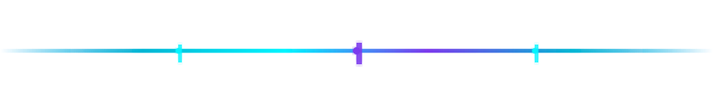
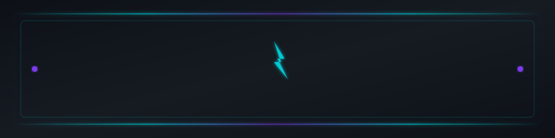
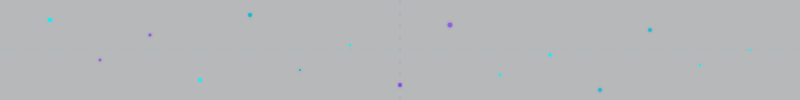

# Assets Guide

This directory contains visual assets for the badhope GitHub Profile README.

## Directory Structure

```
assets/
├── banner/
│   └── hero-cyber-banner.svg    # Hero zone banner with cyberpunk frame
├── dividers/
│   ├── cyber-divider.svg        # Neon gradient horizontal divider
│   ├── pulse-line.svg          # Pulsing energy line with particles
│   └── lightning-wave.svg       # Lightning/wave pattern divider
├── effects/
│   └── particle-grid.svg       # Decorative particle grid background
└── README-assets-guide.md      # This file
```

## Usage

### Dividers

Reference in README.md using standard markdown:

```markdown

```

Or use raw GitHub URLs when hosted:

```markdown

```

### Banner

The hero banner can be used as a decorative header element:

```markdown

```

### Effects

Particle grid works well as section background decoration:

```markdown

```

## Customization

All SVG assets use these color schemes by default:

| Color | Hex | Usage |
|-------|-----|-------|
| Cyan | `#00F5FF` | Primary accent, glow effects |
| Purple | `#7c3aed` | Secondary accent |
| Blue | `#06b6d4` | Tertiary accent |
| Sky | `#0ea5e9` | Badge colors |
| Dark BG | `#0d1117` | Background |

## Future Enhancements

Planned additions:
- Animated SVG placeholders (CSS-based, GitHub-compatible)
- More divider variants (wave, circuit patterns)
- Profile Heat / Reach Index custom badge SVGs
- Tech stack specialized icons
